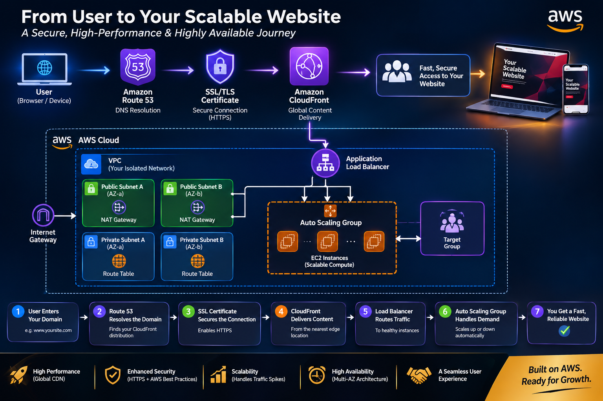
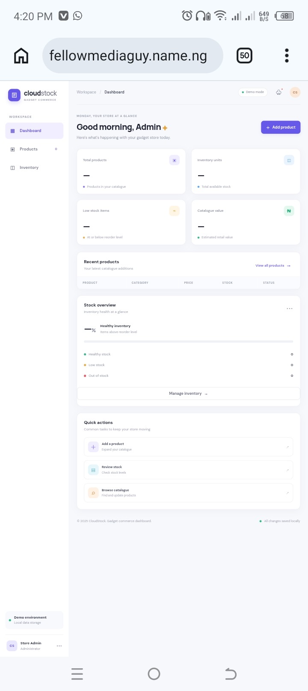
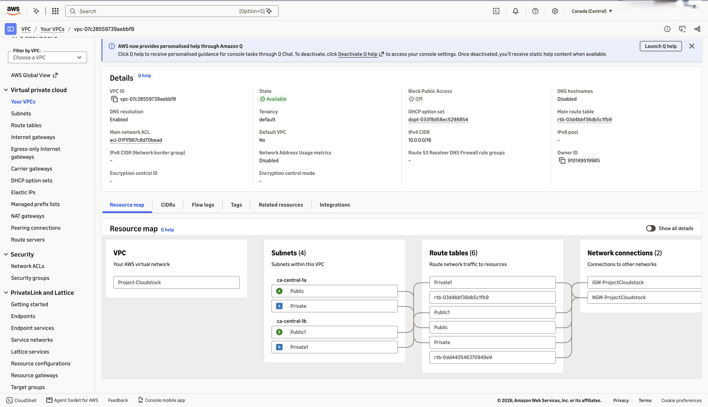
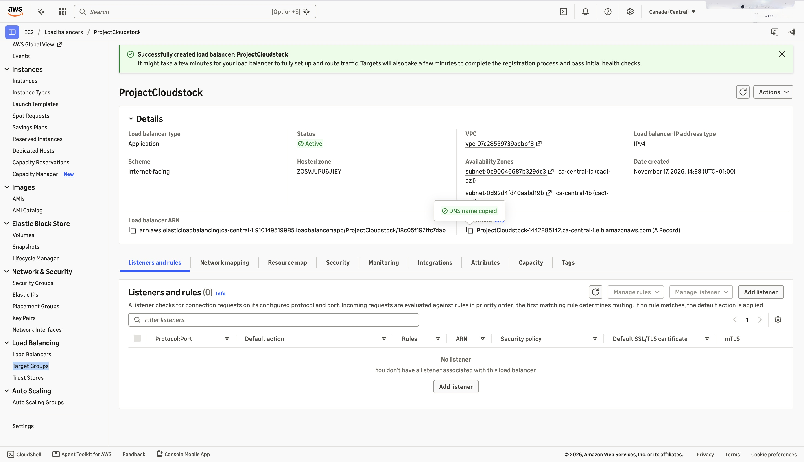
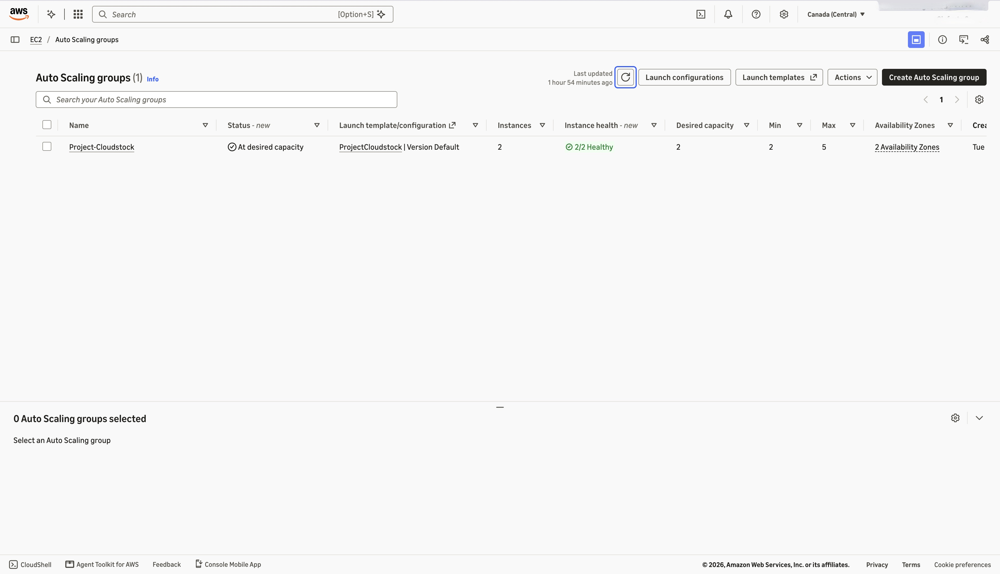
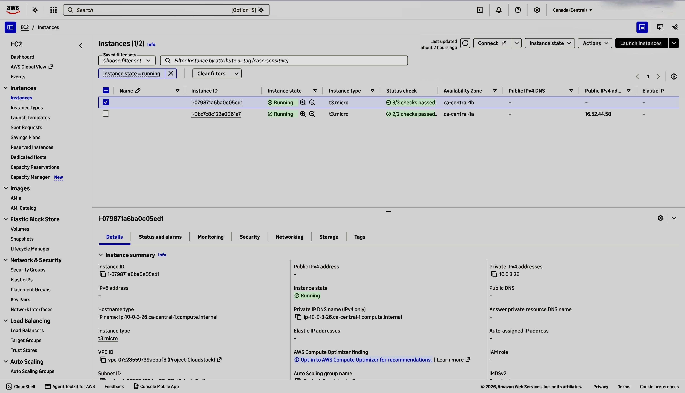
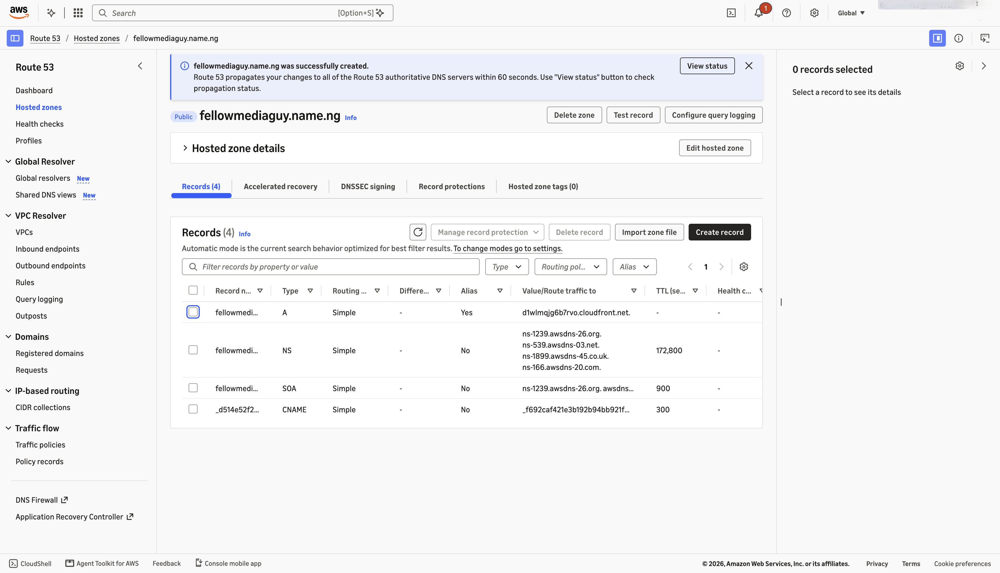
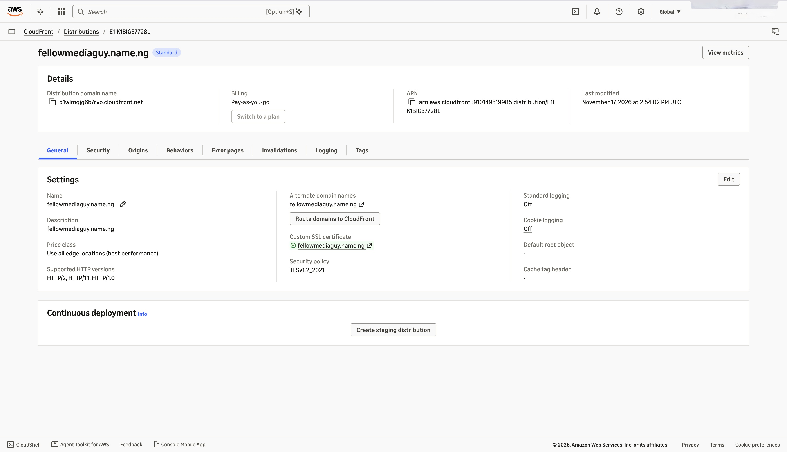
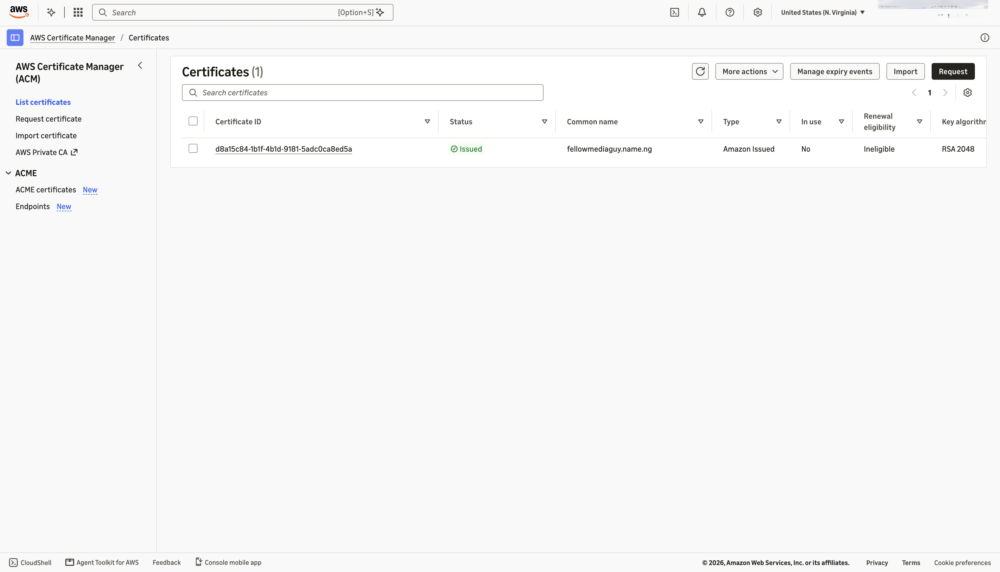
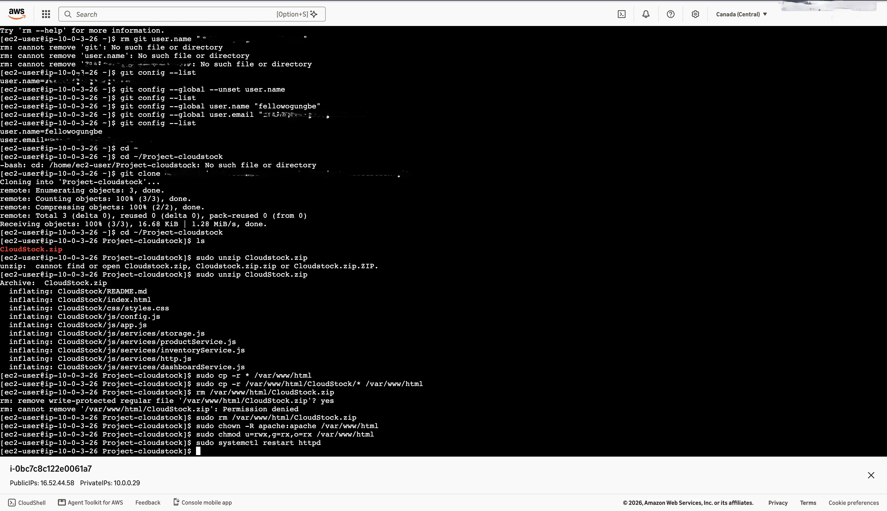

# CloudStock — Gadget Commerce Frontend

CloudStock is a responsive HTML/CSS/JavaScript frontend for a gadget e-commerce and inventory management demo. It is designed as a frontend starter for a cloud engineering / microservices project.

## AWS Cloud Architecture & Deloyment

This application was deployed on AWS using hughly available, multi-AZ architecture with end-to-end HTTPS encryption:

- **DNS & Edge Delivery:** Amazon Route 53 custom domain (`fellowmediaguy.name.ng`) routed to an Amazon CloudFront distribution secured with an AWS Certificate Manager (ACM) TLS certificate (`us-east-1`).
- **Load Balancing & High Availability:** Application Load Balancer (ALB) distributing traffic across EC2 instances managed by an Auto Scaling Group across multiple Availability Zones.
- **Network Isolation:** Custom VPC with public subnets (ALB and NAT Gateways) and private subnets (EC2 web servers) to restrict direct public internet access to backend instances.

### Architecture Diagram


### Deployment Proof
#### 1. Live Application Over Custom Domain (HTTPS)


#### 2. VPC


#### 3. Application Load Balancer & Healthy Multi-AZ Targets


#### 4. Auto Scaling Group


#### 5. Instances


#### 6. Hosted Zones


#### 7. CloudFront Distribution


#### 8. SSL Configuration


#### 9. Code


*(Note: To follow AWS FinOps best practices, active compute and networking resources—NAT Gateways, ALB, and EC2 instances—were torn down after end-to-end verification to avoid idle Free Tier credit consumption.)*

## Included features

- Dashboard summary cards: product count, units in stock, low-stock count, catalogue value
- Product catalogue: add, edit, delete, search, and filter products
- Inventory management: stock status, quantity updates, CSV export
- Demo data stored in browser `localStorage`
- Separated service modules for products, inventory, dashboard summaries, and HTTP requests
- Responsive desktop and mobile layout
- No build tools or framework required

## Run locally

Because JavaScript modules are used, serve the folder over HTTP rather than opening `index.html` directly.

### Option 1: Python
From the extracted `CloudStock` folder, run:

```bash
python3 -m http.server 8080
```

Then open <http://localhost:8080> in your browser.

### Option 2: VS Code
Install/use the Live Server extension, right-click `index.html`, and choose **Open with Live Server**.

## Project structure


```text
├── index.html
├── README.md
└── images/
│   └── images/Architectural_Image.png
│   └── images/Livewebsite.JPG
│   └── images/1VPC.jpeg
│   └── images/3LoadBalancer.jpeg
│   └── images/4AutoScalingGroup.jpeg
│   └── images/5Instances.jpeg
│   └── images/6HostedZones.jpeg
│   └── images/7Distributions.jpeg
│   └── images/8CertificateManager.jpeg
│   └── images/9Code.jpeg
├── css/
│   └── styles.css
└── js/
    ├── app.js
    ├── config.js
    └── services/
        ├── dashboardService.js
        ├── http.js
        ├── inventoryService.js
        ├── productService.js
        └── storage.js
        
```

## Demo mode

The app starts in demo mode. The first load seeds sample gadget products into `localStorage`. Changes you make in the UI persist in that browser until site data is cleared.

To reset the sample data, open browser developer tools → Application/Storage → Local Storage and delete keys beginning with `cloudstock:`. Reload the page.

## Connect your backend APIs

1. Deploy your backend services and make sure their API endpoints are reachable from the browser.
2. Configure CORS on the backend to allow the frontend origin.
3. Open `js/config.js` and set:

   ```js
   export const config = {
     mode: "api",
     apiBaseUrl: "https://your-api-domain.example/api",
     lowStockDefault: 5
   };
   ```

4. Update the paths and response shapes in the service modules to match your actual API contract.
5. Serve the frontend over HTTPS in production.

### Expected API contract (example)

The included API mode expects these endpoints by default:

| Method | Path | Purpose | Example response |
|---|---|---|---|
| GET | `/products` | List products | `[{ "id":"p1", "name":"iPhone", "sku":"IP-01", "category":"Smartphones", "price":800000, "stock":5, "reorderLevel":3, "condition":"Brand new" }]` |
| POST | `/products` | Create product | Created product JSON |
| PATCH | `/products/:id` | Update product | Updated product JSON |
| DELETE | `/products/:id` | Delete product | `204 No Content` or successful JSON |
| GET | `/inventory` | List stock records | Array of products/stock records |
| PATCH | `/inventory/:id` | Update quantity | Updated inventory record |
| GET | `/dashboard/summary` | Dashboard metrics | `{ "totalProducts":8, "totalUnits":44, "lowStock":2, "outOfStock":1, "healthy":5, "catalogueValue":1000000 }` |

These are example paths, not running services. If your backend uses separate URLs for product, inventory, or dashboard services, update the service modules accordingly. For example, `productService.js` can use a product service URL while `inventoryService.js` uses an inventory service URL. Keep secrets and credentials out of frontend JavaScript.

## Suggested microservices mapping

- **Product service:** product metadata and catalogue CRUD
- **Inventory service:** stock quantities, reorder levels, stock updates
- **Dashboard/reporting service:** aggregate metrics for the UI

For a classroom demo, the frontend modules are separated by responsibility. The localStorage mode is a frontend simulation, not actual distributed microservices. Real microservices run as independent backend processes/services and communicate through APIs.

## Notes

- Currency is Nigerian naira (NGN); change formatting in `js/app.js` if needed.
- Google Fonts are loaded from the web. The page uses fallback fonts if they are unavailable.
- This is a starter template. Add server-side validation, authentication/authorization, API error handling, and secure deployment before using it for real customers.
